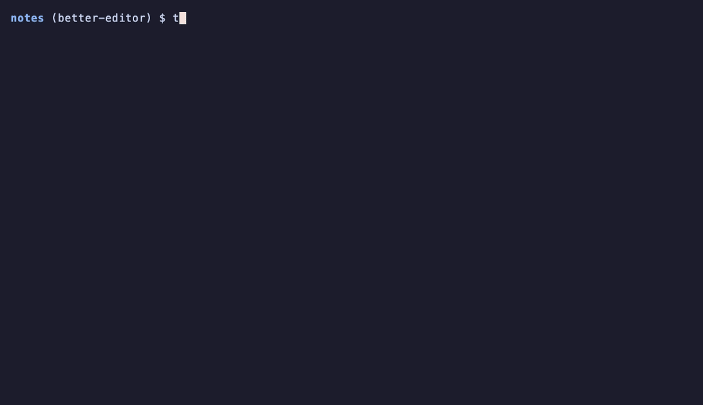

<h1></h1>

[](https://github.com/cicerohellmann/taskboard/actions/workflows/test.yml)



Task Board (`tb`) runs Gradle tasks.

- Type `tb` in the project root. The menu opens.
- Tick the tasks. Pick the modules for each task. Pick the test classes.
- Run. tb runs everything in one command, in step order.

## Why

I've always had trouble with long custom commands that always keep changing, specially in big projects.

tb does two things:

1. **Auto.** tb finds the changed modules, and the modules that depend on them, and runs your `auto` tasks there.
2. **By hand.** You go deep into your tasks and your modules. You pick the tasks, the modules for each task, and the test classes for each test task.

## Words

| Word | What it means |
|---|---|
| task | A Gradle task. Example: `testDebugUnitTest`. |
| task list | The tasks tb shows. It comes from the `.tb` file. |
| module task | A task you run on modules you pick. |
| whole-project task | A task that runs on the whole project. Example: `clean`. |
| fixed-module task | A task that always runs on one module. Example: `:app:assembleDebug`. |
| `auto` task | A task marked `auto` in the task list. Your standard checks: lint, detekt, unit tests. |
| changed module | A module with a changed file on your branch. See [Auto](#auto). |
| affected module | A changed module, or a module that depends on a changed module. See [Auto](#auto). |
| tick | Select a row. ENTER ticks one row. TAB ticks several rows. CTRL-A ticks every row shown. |
| preset | A saved set of ticked tasks, with their modules and test classes. |
| step | The run order of a task, 1 to 6. See [Step order](#step-order). |

## Install

tb needs `bash`, `git` and [fzf](https://github.com/junegunn/fzf) 0.46 or newer.

macOS or Linux, with Homebrew:

```sh
brew install cicerohellmann/tap/tb
```

Homebrew installs fzf too.

Without Homebrew:

```sh
curl -fsSL https://raw.githubusercontent.com/cicerohellmann/taskboard/main/install.sh | bash
```

- The installer puts `tb` in `~/.local/bin`. Set `TB_BIN` to use another folder.
- If fzf is missing or older than 0.46, the installer puts fzf in `~/.fzf` and links it next to `tb`.
- The installer needs `curl` and `git`.

## Try it

```sh
demo/make-project.sh /tmp/tb-demo && cd /tmp/tb-demo && tb
```

This makes the project from the GIF. Its `./gradlew` only prints the task names.

## Set it up

1. Run `tb init` in the project root. It writes `.tb` with the built-in Android task list.
2. Edit `.tb`. Keep your project's tasks. Delete the rest. Format: [The .tb file](#the-tb-file).
3. Mark your standard checks `auto`.
4. Commit `.tb`. Your team and their AI agents use the same task list.

[`example/.tb`](example/.tb) is a full example.

## Set it up with an AI agent

Paste this into Claude Code, Codex or another agent, inside your project:

```text
Set up tb (https://github.com/cicerohellmann/taskboard) for this project.

1. Find out which build commands this project uses:
   - my shell history (~/.zsh_history, ~/.bash_history): ./gradlew lines run in this project
   - CI workflow files (.github/workflows, .gitlab-ci.yml, bitrise.yml and similar)
   - build scripts and the plugins they apply (Detekt, Ktlint, Spotless, Paparazzi, Kover...)
   - README and CONTRIBUTING
2. Run `tb init`, then rewrite .tb with those tasks, following the format and comments in it.
   Mark the standard checks someone should run before pushing (lint, static analysis, formatting
   checks, unit tests) as `auto`. Don't add tasks the project doesn't have.
3. Check it with `tb list` and `tb print auto`.
4. Add the output of `tb agents` to AGENTS.md or CLAUDE.md.
```

## The .tb file

One task per line:

```
# step | label                    | task              | where  | auto
3      | Android lint             | lintDebug         | module | auto
4      | Unit tests               | testDebugUnitTest | module | auto
5      | Build debug APK          | assembleDebug     | :app
1      | Clean                    | clean             | root
3      | Detekt (static analysis) | detekt            | root   | auto
2      | Ktlint: fix formatting   | ktlintFormat      | root
```

| Column | What it means |
|---|---|
| step | The run order, 1 to 6. See [Step order](#step-order). |
| label | The name in the menu. |
| task | The Gradle task. |
| where | `module`: a module task. `root`: a whole-project task. `:name`: a fixed-module task on module `:name`. |
| auto | `auto`: an `auto` task. |

Where tb looks for the task list:

1. `.tb` in the project root.
2. `~/.config/tb/commands`.
3. The built-in Android task list.

Other files:

| File | What it holds |
|---|---|
| `~/.config/tb/presets/<project folder>/` | Presets. Projects with the same folder name share presets. |
| `~/.tb_history` | History of the commands tb ran. |
| `~/.cache/tb/` | The module list. tb reads it again when `settings.gradle` or `settings.gradle.kts` changes. `tb refresh` reads it again now. |

## Step order

tb runs the tasks in this order, always:

| Step | Tasks |
|---|---|
| 1 | clean |
| 2 | tasks that change files (formatting) |
| 3 | checks |
| 4 | tests |
| 5 | builds |
| 6 | reports |

- Steps 1 and 2 run as their own `./gradlew` call first. Then `&&` runs steps 3 to 6.
- Tasks in the same step run in the order of the task list.
- A task that is not in the task list runs last.

## Auto

- A changed module is a module with a changed file on your branch.
- Changed files: the files changed since your branch left `main` (`origin/main` first, then `main`), plus uncommitted and new files.
- A file belongs to the deepest module folder that contains it.

Affected modules:

- An affected module is a changed module, or a module that depends on a changed module.
- Dependencies of dependencies count too. `:app` uses `:feature`, `:feature` uses `:core`, `:core` changed: all three are affected.
- tb reads the dependencies from each module's `build.gradle` or `build.gradle.kts`.
- tb finds `project(":core")`, `project(path = ":core")`, `project(path: ':core')` and `projects.core`.
- Lines that start with `//` don't count.
- tb does not run Gradle for this. Dependencies added by plugins or convention plugins are not found.

Auto ticks the `auto` tasks:

- `auto` module tasks run on the affected modules.
- `auto` whole-project tasks run on the whole project.
- No changed modules: Auto ticks nothing. `tb run auto` and `tb print auto` exit with 1.

Run Auto from the shell:

```sh
tb run auto
```

Run Auto from the menu: tick `★ Auto`, then tick `▶ Run`.

## By hand

1. Type `tb`.
2. Tick a module task. The modules screen opens.
3. Tick the modules. ENTER.
4. For a test task (the task name has `UnitTest` or `Paparazzi`), the test classes screen opens. Tick the test classes. ENTER.
5. You are back in the main menu. The task has a `✓`.
6. Tick more tasks. Whole-project tasks and fixed-module tasks tick with ENTER. ENTER again unticks them.
7. Tick `▶ Run`. Tick `✔ Confirm, run it`.

## The menu, row by row

The row text is in `code`.

### Main menu

The rows, from the top:

| Row | What it does |
|---|---|
| `● before-push  ·  Unit tests, Clean` | A preset. ENTER opens the preset screen. DEL deletes it. |
| `▶ Run` | Opens the run screen. |
| `💾 Save as preset` | Opens the save screen. |
| `★ Auto: checks on changed modules and their dependents (:garden, :notes:editor)` | Ticks the `auto` tasks. See [Auto](#auto). Shows only when there are changed modules. |
| `  Instrumented tests (needs a device)` | A task, not ticked. ENTER opens its modules screen. |
| `✓ Unit tests  → :garden, :notes:editor · 1 test class` | A ticked module task, with its modules and test classes. ENTER opens its modules screen again. |
| `✓ Clean  → whole project` | A ticked whole-project task. ENTER unticks it. |

The lines above the rows:

| Line | What it shows |
|---|---|
| `★ Added the auto checks; module ones on :garden, :notes:editor` | What the last action did. |
| `./gradlew --continue --parallel --console=rich :garden:lintDebug :notes:editor:lintDebug` | The command that will run. |
| `then ./gradlew ...` | The second `./gradlew` call, when steps 1 or 2 are ticked. |

### Modules screen

| Row | What it does |
|---|---|
| `✖ Remove Unit tests from the list` | Unticks the task. Shows only when the task is ticked. |
| `◆ ALL MODULES` | Runs the task on every module. No test classes screen. |
| `◆ CHANGED AND DEPENDENT MODULES (3)` | Adds the affected modules. The number is how many. Shows only when there are affected modules. |
| `★ :garden` | A changed module. Changed modules are at the top. |
| `☆ :app` | A module that depends on a changed module. These come after the changed modules. |
| `:settings` | A module. |

The lines above the rows:

| Line | What it shows |
|---|---|
| `For: Unit tests` | The task. |
| `★ changed · ☆ depends on a changed one · TAB tick · type to filter · CTRL-A tick all shown · ENTER next · ESC back` | The marks and the keys. |

- The modules the task already has are ticked when the screen opens.
- `◆ CHANGED AND DEPENDENT MODULES` adds the same modules as `tb affected`.
- CTRL-A ticks every row shown. Type to filter first to tick only some rows.
- ENTER keeps the ticked modules.

### Test classes screen

| Row | What it does |
|---|---|
| `◆ ALL tests in these modules` | Runs every test class in the picked modules. |
| `★    MarkdownParserTest  (:notes:editor)` | A test class in a changed file. Changed test classes are at the top. |
| `  📸 EditorScreenshotTest  (:notes:editor)` | A screenshot test class. The file has the word `paparazzi`. |

The lines above the rows:

| Line | What it shows |
|---|---|
| `For: Unit tests` | The task. |
| `TAB tick · CTRL-A tick all shown · ★ changed · 📸 screenshot · ENTER done · ESC keep all` | The keys and the marks. |

- Test classes are the `*Test.kt` and `*Tests.kt` files in `src/test`.
- A module with none of the ticked test classes is dropped from the task.
- Paparazzi tasks get only screenshot test classes.
- CTRL-A ticks every row shown. Type to filter first to tick only some rows.
- ESC keeps the test classes you had before.

### Run screen

| Row | What it does |
|---|---|
| `./gradlew ... clean && ./gradlew ... :notes:editor:testDebugUnitTest` | The command. |
| `✖ Cancel, back` | Goes back to the main menu. |
| `✔ Confirm, run it` | Runs the command. |

### Save screen

| Row | What it does |
|---|---|
| `name > before-push` | Type the preset name. ENTER saves. ESC cancels. |

- A name that exists already: the preset is overwritten.
- `/` in the name becomes `-`.

### Preset screen

| Row | What it does |
|---|---|
| `▶ Run it` | Runs the preset's command. |
| `🗑 Delete preset` | Asks, then deletes the preset. |

## Keys

| Key | What it does |
|---|---|
| ENTER | Ticks the row. On a module task in the main menu, opens its modules screen. |
| TAB | Ticks several rows. |
| CTRL-A | Ticks every row shown. On the modules screen and the test classes screen. |
| DEL / CTRL-D | Deletes a preset. |
| ESC | Goes back. On the main menu, quits. |

## Not only Gradle

tb is designed for Gradle. You can use it with anything else.

Add a `runner:` line to `.tb` or `~/.config/tb/commands`:

```
runner: make -k
```

- tb puts the tasks after the runner, in step order.
- Steps 1 and 2 still run as their own call: `make -k clean fmt && make -k lint`.
- Without `./gradlew`, there are no modules. Every task is a whole-project task.
- Without `./gradlew`, Auto ticks every `auto` task.
- Several `runner:` lines: the last one counts.
- No `./gradlew` and no `runner:` line: tb exits with 1.

The default runner is `./gradlew --continue --parallel --console=rich`.

## For scripts and AI agents

- These commands never open the menu, except `tb hist`.
- `tb` with no terminal prints the help and exits with 0. `TB_INTERACTIVE=1` opens the menu anyway.

| Command | What it does |
|---|---|
| `tb run auto` | Runs the `auto` tasks. See [Auto](#auto). |
| `tb print auto` | Prints the same command. Does not run it. |
| `tb run SPEC...` | Runs these tasks. Exits with the build's exit code. |
| `tb print SPEC...` | Prints the command for these tasks. |
| `tb list` | Lists the task list: step, task, where, auto, label. |
| `tb modules` | Lists every module. |
| `tb changed` | Lists the changed modules. |
| `tb affected` | Lists the affected modules. |
| `tb presets` | Lists this project's presets. |
| `tb history` | Lists this project's last 20 commands, without repeats. |
| `tb last` | Runs this project's last command again. |
| `tb hist` | Opens a menu of this project's commands. Runs the one you pick. |
| `tb init` | Writes `.tb`. Exits with 1 if `.tb` exists. |
| `tb refresh` | Reads the module list again. Prints the number of modules. |
| `tb agents` | Prints a note for AGENTS.md or CLAUDE.md. |
| `tb help` | Prints the help. Same as `tb -h` and `tb --help`. |

SPEC is one of:

| SPEC | What it means |
|---|---|
| `task` | A whole-project or fixed-module task. Example: `detekt`. |
| `task=:a,:b` | A module task on modules `:a` and `:b`. The `:` is optional: `task=a,b`. |
| `task=ALL` | A module task on every module. |
| `task=changed` | A module task on the changed modules. |
| `task=affected` | A module task on the affected modules. |
| `auto` | The `auto` tasks. |
| `@name` | A preset. |

Example, in the demo project (built-in task list, `detekt` is not in it):

```sh
tb print clean detekt testDebugUnitTest=changed
# ./gradlew --continue --parallel --console=rich clean && ./gradlew --continue --parallel --console=rich :garden:testDebugUnitTest :notes:editor:testDebugUnitTest detekt
```

- A task that is not in the task list goes to the build as it is, last. Anything after `=` is dropped.
- An error exits with 1 and says what is wrong. Errors: an unknown module, a module task with no `=`, an unknown preset, no SPEC, an unknown command, Auto with no changed modules.

## Tests

```sh
tests/run.sh
```

- The tests use a fake Gradle project and a fake fzf.
- They need no Gradle, no Android SDK and no terminal.
- GitHub Actions runs them on Linux and macOS on every push.
- GitHub Actions also runs `install.sh` on a clean Linux machine.

## How we built it

[HOW-WE-BUILT-IT.md](HOW-WE-BUILT-IT.md): what we thought about, what we changed, tools like this one, and the references.

## License

[The Unlicense](LICENSE). Copy it, change it, sell it, do whatever you want with it.
