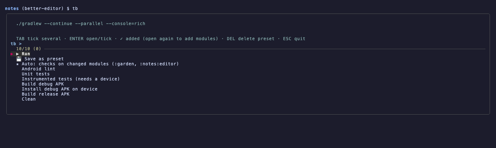
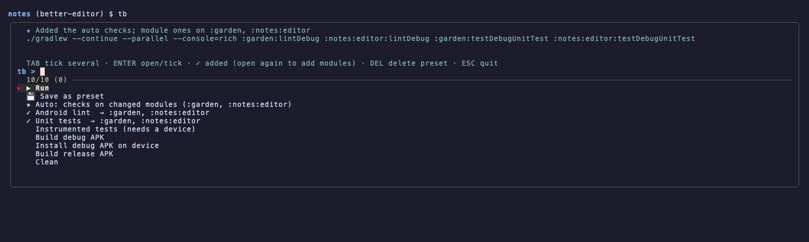
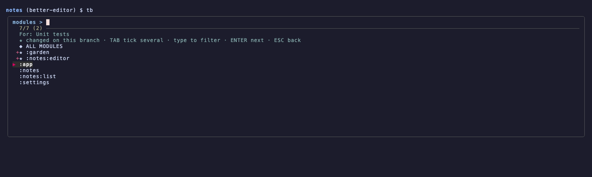
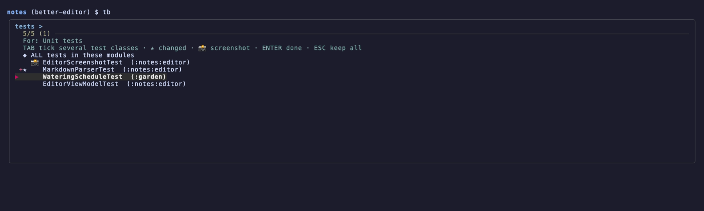
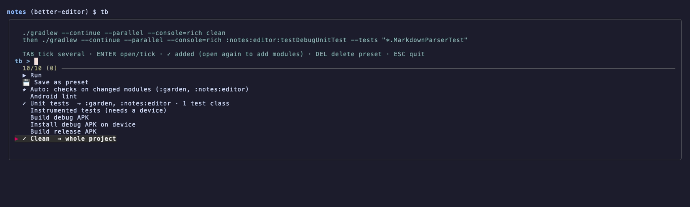
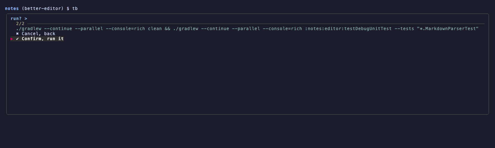
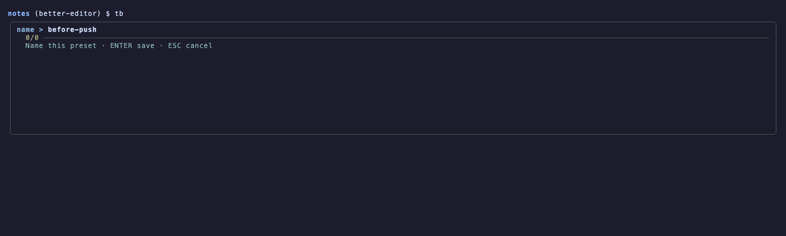
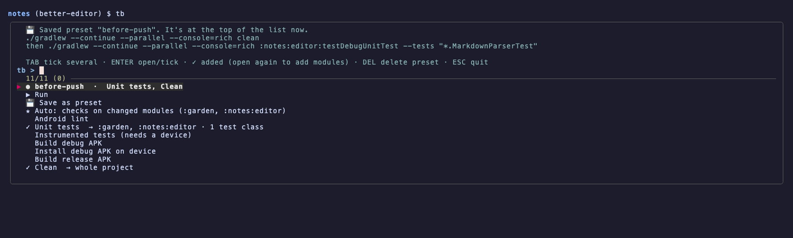
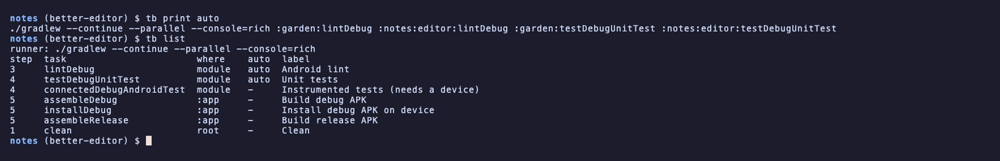

<h1></h1>

[](https://github.com/cicerohellmann/taskboard/actions/workflows/test.yml)


**Task Board** (`tb`): tick the Gradle tasks you want, pick the modules, press Run.

Like you, I've always had trouble testing exactly what I want to test. Run everything and you wait forever.
Run one thing by hand and you're retyping long task paths and forgetting which task does what. tb is
what I built for that: one place to say "these checks, on these modules, these test classes", and it builds
the command in the right order.

It's designed for Gradle (Android projects especially), but it can drive other build tools too
(see [Not only Gradle](#not-only-gradle)).

## ★ Auto: the main feature

tb finds the modules changed on your branch (compared with `main`, including uncommitted and new files)
and runs your standard tools on them: the ones you marked `auto` in `.tb`, like lint, Detekt, Ktlint and
unit tests. One command:

```sh
tb run auto
```

or the ★ Auto row in the menu.

## Going deep, by hand

When Auto isn't what you want, you choose every part: which commands, which modules for each one, and which
test classes inside those modules. However you tick things, they run in the right order (clean first, then
formatting, checks, tests, builds, reports), and anything that changes files runs as its own build first.

## What each row does

The menu: ▶ Run, 💾 Save and ★ Auto first, then your commands.



★ Auto adds lint and unit tests on the modules changed on your branch.



Opening a command lets you pick its modules; the changed ones are starred and on top.



Narrow a test command down to a few test classes.



Whole-project commands like Clean just tick in place; clean runs as its own first build.



▶ Run shows the full command before running it.



💾 saves the current selection as a preset.



Next time, your presets sit at the top of the menu.



For scripts and AI agents: `tb print` and `tb list` answer without opening a menu.



`tb last` reruns the last command and `tb hist` picks one from before.

## Install

```sh
brew install cicerohellmann/tap/tb
```

That's it on macOS (and Linux with Homebrew); it brings fzf along. Without Homebrew, the installer puts `tb`
in `~/.local/bin` and installs fzf 0.46+ if yours is missing or older:

```sh
curl -fsSL https://raw.githubusercontent.com/cicerohellmann/taskboard/main/install.sh | bash
```

## Set it up for your project

1. `tb init` writes a `.tb` in the project root.
2. Edit it to list your project's commands.
3. Mark your standard tools `auto`.
4. Commit it, so your team and their agents share the list.

[`example/.tb`](example/.tb) is a fuller example (formatting, Detekt, Paparazzi, Kover and more).

## Set it up with an AI agent

Paste this into Claude Code, Codex or a similar agent, inside your project:

```text
Set up tb (https://github.com/cicerohellmann/taskboard) for this project.

1. Find out which build commands this project really uses:
   - my shell history (~/.zsh_history, ~/.bash_history): ./gradlew lines run in this project
   - CI workflow files (.github/workflows, .gitlab-ci.yml, bitrise.yml and similar)
   - build scripts and the plugins they apply (Detekt, Ktlint, Spotless, Paparazzi, Kover...)
   - README and CONTRIBUTING
2. Run `tb init`, then rewrite .tb with those commands, following the format and comments in it.
   Mark the standard checks someone should run before pushing (lint, static analysis, formatting
   checks, unit tests) as `auto`. Don't add tasks the project doesn't have.
3. Check it with `tb list` and `tb print auto`.
4. Add the output of `tb agents` to AGENTS.md or CLAUDE.md.
```

## Configuration

`.tb` has one command per line:

```
# step | label                    | task              | where  | auto
3      | Android lint             | lintDebug         | module | auto
4      | Unit tests               | testDebugUnitTest | module | auto
5      | Build debug APK          | assembleDebug     | :app
1      | Clean                    | clean             | root
3      | Detekt (static analysis) | detekt            | root   | auto
2      | Ktlint: fix formatting   | ktlintFormat      | root
```

| Column | Meaning |
|---|---|
| step | Run order: 1 clean, 2 changes files, 3 checks, 4 tests, 5 build, 6 reports. Steps 1-2 run as their own build first. |
| label | What you see in the menu. |
| task | The task name. |
| where | `module`: you pick modules. `root`: whole project, just a tick. `:something`: always that module. |
| auto | `auto` means ★ Auto adds it. |

A `runner:` line sets the command the tasks are passed to (see below).

Without a `.tb`, tb uses `~/.config/tb/commands` if it exists, otherwise a standard Android list.
Modules come from `./gradlew projects`, cached until your settings files change; `tb refresh` re-reads
them. Presets live in `~/.config/tb/presets/`, history in `~/.tb_history`.

## Not only Gradle

By default the command is `./gradlew --continue --parallel --console=rich` followed by your tasks. To use
another tool, add a `runner:` line to `.tb`:

```
runner: make -k
```

or `runner: just`, and so on. The tasks are appended to it in run order.

Picking modules and test classes needs Gradle (a `./gradlew` in the project). With another runner, module
commands run on the whole project, and `tb list` shows the runner in use. Ticks, run order, presets, history and ★ Auto work with any runner; without modules, ★ Auto simply
adds every `auto` command.

## Keys

| Key | |
|---|---|
| ENTER | open a command, or tick a whole-project one |
| TAB | tick several |
| DEL / CTRL-D | delete a preset |
| ESC | back / quit |

## For AI agents and scripts

These never open a menu and need no terminal. Plain `tb` with no terminal attached prints the help.

```sh
tb run auto          # the auto checks on the changed modules
tb print auto        # the same command, printed instead of run
tb list              # the commands: step, task, where, auto, label
tb agents            # a note to paste into AGENTS.md / CLAUDE.md
```

More: `tb modules`, `tb changed`, `tb presets`, `tb history`, `tb help`.

```sh
tb print clean detekt testDebugUnitTest=changed
# ./gradlew ... clean && ./gradlew ... detekt :notes:editor:testDebugUnitTest
tb run lintDebug=:garden assembleDebug
```

What `print` and `run` take:

| | |
|---|---|
| `task` | a whole-project or fixed-module command, e.g. `detekt` |
| `task=:a,:b` | a per-module command on those modules (`=ALL` and `=changed` work too) |
| `auto` | the auto checks, on the modules changed on this branch |
| `@name` | a saved preset |

Anything not in the list is passed to the build as it is. Mistakes (unknown module, missing modules,
unknown preset) exit with 1 and say what's wrong.

## Try it without an Android project

```sh
demo/make-project.sh /tmp/tb-demo && cd /tmp/tb-demo && tb
```

This builds the made-up project from the GIF, with a stand-in `./gradlew` that only prints task names.
`vhs demo/demo.tape` re-records the GIF.

## Tests

```sh
tests/run.sh
```

The tests use a small fake Gradle project and replace fzf with a script that plays back key presses, so they
need no Gradle, Android SDK or terminal. GitHub Actions runs them on Linux and macOS on every push.

## License

[The Unlicense](LICENSE): public domain. Anyone can copy, modify, sell or do anything with it, no conditions.
